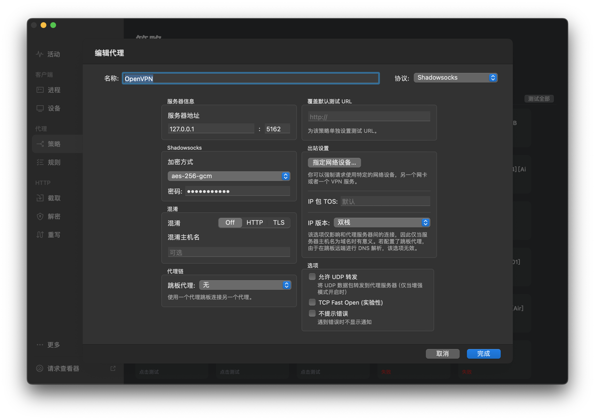

# OpenVPN2SS

> 现代网络环境中，生产或特定网络为确保其网络安全，往往会使用 VPN 网络做接入管制。
>
> 在这种复杂网络环境下，OpenVPN 客户端经常会与 Clash、Surge 等网络调试工具存在 DNS 抢占问题。当用户存在多套 OpenVPN 网络时，还需要频繁在不同 OpenVPN 配置间切换，非常繁琐。

OpenVPN2SS 将 OpenVPN 客户端通过 SSServer 转化为 `ss://` 协议。通过将不同的 OpenVPN 链路封装在独立的 Docker 容器中暴露不同的本地 SS 端口，并由 Clash/Surge 等网络工具做域名分流，可彻底解决 DNS 抢占及多套网络频繁切换的问题。

## 目录结构

```bash
.
├── Dockerfile                   # 基于 Alpine 的镜像源文件（集成 OpenVPN、ssserver 与 dnsmasq）
├── docker-compose.yml           # Docker Compose 编排文件
├── docker-entrypoint.sh         # 容器启动与就绪检测、DNS 接管脚本
├── .env.example                 # 环境变量配置模板
├── config                       # 配置文件目录
│   ├── openvpn                  # OpenVPN 证书与认证配置目录（gitignore 保护）
│   │   ├── ca.crt
│   │   ├── openvpn.ovpn
│   │   ├── pass.txt
│   │   ├── ta.key
│   │   ├── user.crt
│   │   └── user.key
│   ├── shadowsocks              # Shadowsocks 服务端配置
│   │   ├── shadowsocks.json     # 服务端配置模板（只读挂载）
│   │   └── shadowsocks.service
│   └── dnsmasq.d                # dnsmasq 自定义解析目录（gitignore 保护）
│       └── README.md            # 自定义域名与泛解析示例说明
├── logs                         # OpenVPN 与运行日志目录（gitignore 保护）
└── README.md
```

## 快速使用

OpenVPN2SS 基于 Docker 设计，支持一键 `docker compose up -d` 运行。运行前请预先准备 **OpenVPN 认证文件** 与 **环境变量**。

### OpenVPN 认证配置

请将你的 OpenVPN 连接所需文件放入 `config/openvpn/` 目录中：

| 文件名称       | 用途说明                                                                                   |
| -------------- | ------------------------------------------------------------------------------------------ |
| `ca.crt`       | 根证书（CA）公钥文件，验证服务器和客户端证书合法性。                                       |
| `openvpn.ovpn` | OpenVPN 配置文件，包含服务器地址、端口、加密算法及路由设置。                               |
| `pass.txt`     | OpenVPN 账号密码文件（可选），每行分别为用户名与密码，用于自动认证。                         |
| `ta.key`       | TLS-Auth 预共享密钥（可选），防止 DoS 攻击与端口扫描。                                     |
| `user.crt`     | 客户端公钥证书文件。                                                                       |
| `user.key`     | 客户端私钥证书文件。                                                                       |

> **提示**：如果某些内网特定 IP 不在 VPN 服务端默认推送的子网路由中，请在 `openvpn.ovpn` 中添加对应路由指令（例如 `route 192.0.2.10 255.255.255.255`），由 OpenVPN 建链时自动下发，无需手动执行 `ip route`。

### 环境变量与密码配置

复制环境变量模板：

```bash
cp .env.example .env
```

编辑 `.env` 文件：

```dotenv
# Shadowsocks 连接密码（必填；若配置文件中存在占位符且未配置此变量将拒绝启动）
SS_PASSWORD=your_secure_password

# 宿主机映射端口（容器内固定 5162）
SS_PORT=5162

# 容器名前缀（默认 openvpn，生成容器名 ${NAME_PREFIX}-client）
NAME_PREFIX=openvpn

# OpenVPN 链路建立超时时间（秒，默认 60）
VPN_READY_TIMEOUT=60

# 是否启用内置 dnsmasq 接管内网 DNS 解析（推荐开启）
ENABLE_DNSMASQ=true

# 显式指定内网上游 DNS 服务器（逗号分隔；若留空则自动提取服务端 push 的 DNS）
# DNS_SERVERS=10.8.0.1,10.8.0.2

# 兜底 DNS 服务器（逗号分隔；在内网 DNS 解析无果或隧道未推送 DNS 时使用）
# DNS_FALLBACK=223.5.5.5,114.114.114.114
```

> **密码注入说明**：容器启动时会通过 `ssserver --password` 命令行参数安全注入密码，无需修改挂载的配置文件，避免了在 Docker bind-mount 下修改挂载文件导致的 `Resource busy` 错误。

### DNS 解析与接管模式

Linux 下 OpenVPN CLI 默认不会主动修改系统的 `/etc/resolv.conf`。而在容器编排中，如果直接在 compose 里静态配置内网 DNS，一旦 OpenVPN 的 `remote` 服务器是域名，就会因无法预先解析 remote 域名而导致死锁断网。

为此，OpenVPN2SS 支持两种 DNS 解析机制：

#### dnsmasq 模式（推荐，`ENABLE_DNSMASQ=true`）

* **自动捕获服务端 CoreDNS / 内网 DNS**：容器在后台监听 OpenVPN 日志，捕获到 `PUSH_REPLY,dhcp-option DNS ...` 后自动将其作为 dnsmasq 的上游，隧道重连时自动热重载上游记录。
* **隔离与防死锁**：OpenVPN 进程自身连接远程服务端始终走 Docker 宿主网络解析；只有 `ssserver` 及应用流量通过内部 `127.0.0.1:53` 解析，彻底避免死锁。
* **自定义泛域名解析与 Split-DNS**：
  * 在 `config/dnsmasq.d/` 下新建 `.conf` 文件（如 `internal.conf`）：
    ```conf
    # 将整个泛域名 *.internal.example.com 指向内网服务 IP
    address=/internal.example.com/192.0.2.10

    # 将特定域名查询转发给指定的内网 DNS 服务器
    server=/corp.example.com/10.8.0.1
    ```
* **单主机映射支持**：可在 `docker-compose.yml` 中继续使用原生的 `extra_hosts`，dnsmasq 会自动读取容器内 `/etc/hosts`。
* **公共 DNS 兜底**：可通过 `DNS_FALLBACK` 配置公网 DNS，防止内网 DNS 未覆盖公网域名时解析彻底瘫痪。

#### 系统解析模式（`ENABLE_DNSMASQ=false`）

关闭内置 dnsmasq，容器直接使用 Docker 或 compose 配置的系统 DNS 解析，适合最简单的纯内网 IP 场景。

### 启动与运行

```bash
docker compose up -d
```

#### 启动就绪时序判定

容器启动时具有健壮的启动顺序保证与 Fail-fast 机制：
1. 启动日志监听流并拉起 OpenVPN。
2. 持续检测 OpenVPN 是否输出 `Initialization Sequence Completed`（表明隧道与路由均已正式安装完毕）。
3. 若 OpenVPN 进程异常崩溃（如认证失败、握手超时），立即向 stderr 输出最近 20 行日志并快速退出，便于排查。
4. VPN 就绪后，拉起 dnsmasq 与 Shadowsocks 服务端，并进行持续进程健康监督。

#### 查看日志与排错

```bash
# 查看容器启动及服务进程状态
docker compose logs -f

# 查看 OpenVPN 完整握手与网络传输日志
tail -f logs/ovpn.log
```

### 多实例部署指南（多套 VPN 容器分流）

如果你有多套不同的 OpenVPN 网络环境需要同时在线，推荐使用多目录或多项目隔离的方式：

**独立目录隔离**

为不同环境建立独立目录，并在各自目录的 `.env` 中指定不同的端口与容器名前缀：

```text
~/docker/openvpn-company-a/  # SS_PORT=5162, NAME_PREFIX=company-a -> 容器名 company-a-client
~/docker/openvpn-company-b/  # SS_PORT=5163, NAME_PREFIX=company-b -> 容器名 company-b-client
```

**单目录多项目隔离**

在同一目录下，通过不同的环境文件和 compose 项目名直接拉起多个实例：

```bash
docker compose --env-file .env.node-a -p vpn-node-a up -d
docker compose --env-file .env.node-b -p vpn-node-b up -d
```

### 客户端（Clash / Surge）接入配置

接入需要使用支持 `ss://` 协议的网络工具，指向本地 `127.0.0.1` 对应的映射端口，使用 `aes-256-gcm` 算法与 `.env` 中设置的密码。

以 Surge 为例：



> **重要提示（域名分流与解析）**：
> 在 Clash 或 Surge 中配置分流规则时，必须将匹配的内网域名流量配置为**由远端代理节点解析（Remote DNS / 代理节点解析）**。若客户端在本地预先发起 DNS 解析，由于本地网络无法触达 VPN 内网 DNS，域名将无法解析成功。
